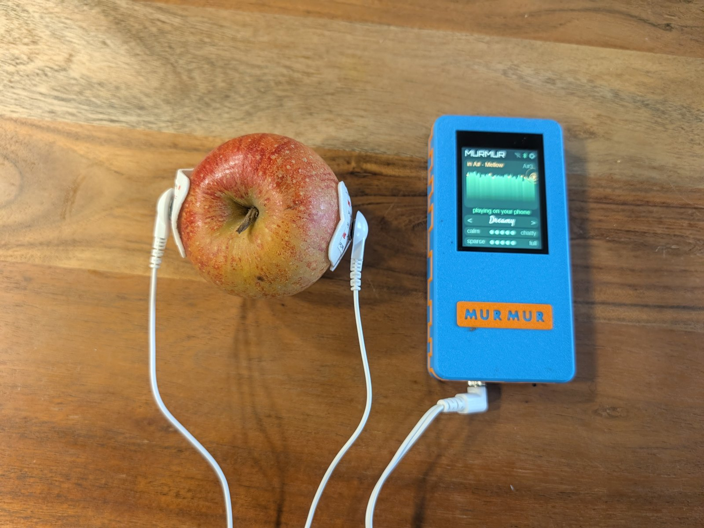
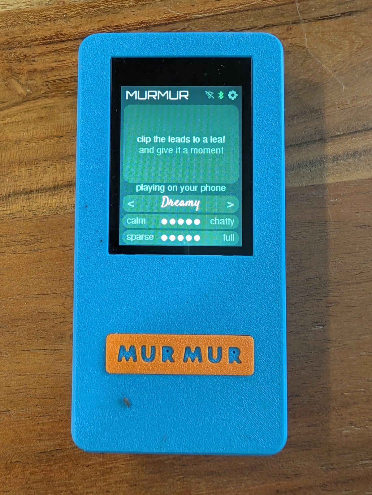
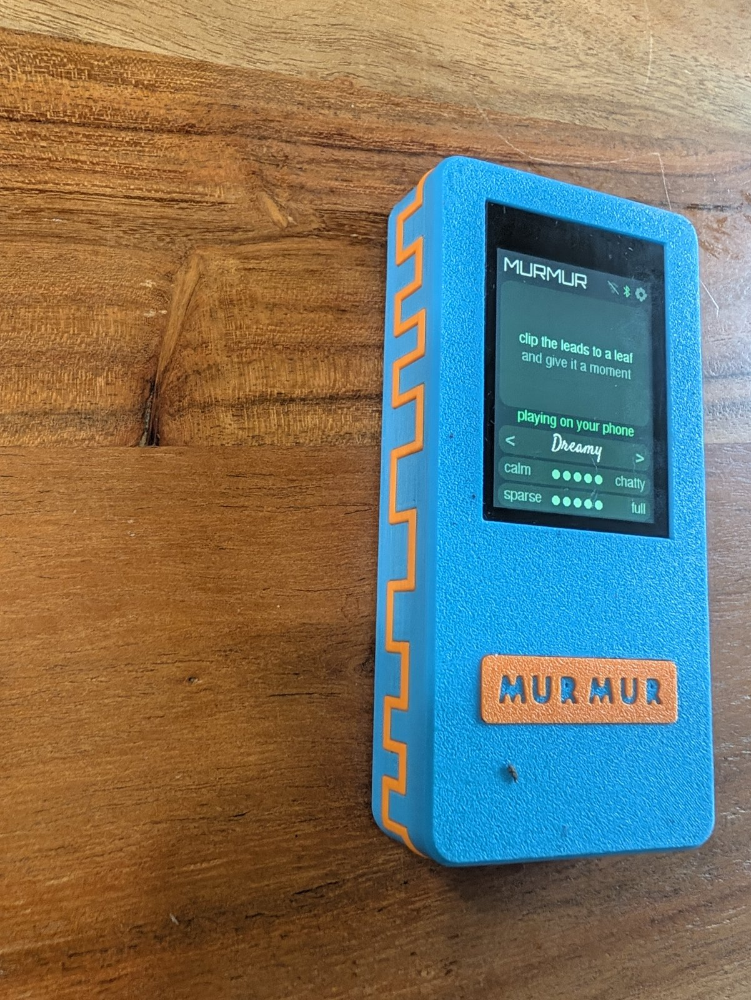
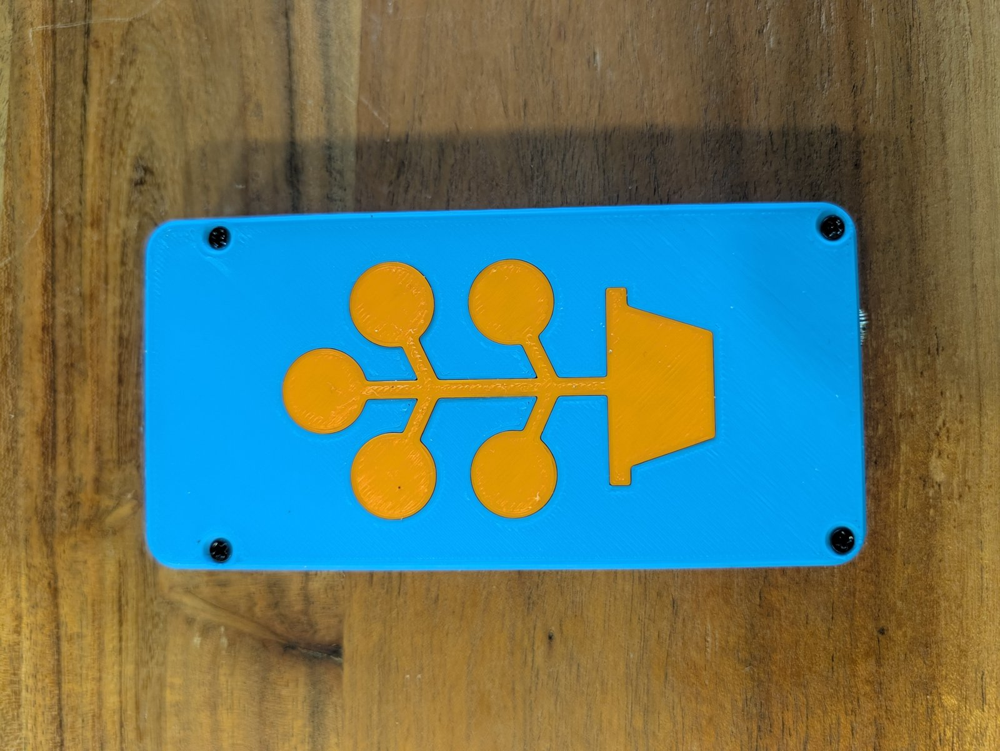

# MURMUR

*An exploration of vegetal agency through stochastic composition.*

MURMUR is a pocket box that lets a plant play music. Clip two pads to a leaf, or two pins into an
apple, and the plant's changing electrical resistance becomes MIDI notes. They go over Bluetooth
to a phone (GarageBand, BandLab, anything that takes MIDI) or over USB to a computer or synth.

Nobody plays it but the plant. There are no keys and no touch pad: you choose a mood and an
instrument, and the plant does the rest.

<p align="center"></p>

| | | |
|---|---|---|
|  |  |  |
| The face: touch screen, inset name | The band all the way round is the 555's square wave | The back: a money plant, inlaid |

## How it works

```
plant ── 3.5 mm jack ── TLC555 (plant = its timing resistor) ── IO17 ── ESP32-S3 ── BLE-MIDI / USB-MIDI
```

A TLC555 oscillates with the **plant as its timing resistor**, so every pulse's length is a reading
of the plant. The ESP32-S3 on an Elecrow CrowPanel 2.4" times the pulses, averages them in windows
of 10 and listens for change.

**The music engine** (`firmware/murmur/murmur.ino`, `onPeriod`):

- **When to play.** A note fires when a change is *unusual for this plant, right now*: big compared
  with its own recent typical movement, scaled by **calm ↔ chatty**. Steady drift raises "typical"
  on its own, so drift alone goes quiet. A jolt plays a burst of notes, then they thin out as the
  plant settles, which gives you an attack and a backoff.
- **Melody.** The direction of the change moves the line up or down the scale, and the size of the
  change decides a step, a skip or a leap. It never repeats a note immediately. Where the reading
  ranks among its last 32 windows gently pulls the line back toward a home pitch.
- **Harmony by strength.** A nudge plays a single note, more plays a dyad, a strong change plays a
  spread triad with the bass an octave down, and a jolt plays an arpeggiated seventh chord.
  **sparse ↔ full** caps how many notes sound at once.
- **Two timescales.** A slow average picks the **register** (low, middle or high). Sustained drift
  walks the **key round the circle of fifths**: rising moves up a fifth, falling moves down, at
  most three steps from home, and it drifts back when the plant settles.
- **Big events** tip the mood to a sister mood (Bright ↔ Moody, Dreamy ↔ Mellow…) for about 25 s.
- **Expression.** Each jolt pushes **CC11** up, and it eases back over about 4 s. **CC74** follows
  the slow level, for filter sweeps.
- **Bass drone** (optional). The key's root and fifth, held on **MIDI channel 2**, so it can have its
  own instrument. Try a sitar with the drone on, which sounds like a tanpura.

**Moods** (scales, named for how they feel): Dreamy (major pentatonic) · Mellow (minor pentatonic) ·
Bright (major) · Moody (minor) · Wistful (Dorian) · Zen (In-Sen) · Floaty (whole tone) · Wild
(chromatic) · Raga (Bhairav).

## Build it

1. **Parts:** [BOM.md](BOM.md).
2. **Wiring:** [WIRING.md](WIRING.md) is a junction list: each line is one joint. The diagram is
   [docs/murmur-schematic.png](docs/murmur-schematic.png).
3. **Print:** the `prints/` folder. The body is a two-colour STEP (body plus accent) printed face
   down. The back plate and plant inlay are separate. Fixings are 4 × M3 × 5 for the board and
   4 × M3 × 10 countersunk for the back.
4. **Firmware:**
   ```sh
   cp firmware/murmur/secrets.h.example firmware/murmur/secrets.h   # Wi-Fi is optional, for updates
   firmware/build.sh            # arduino-cli, esp32 core 3.3.x, LovyanGFX
   ```
   Board settings are in `firmware/build.sh`: ESP32-S3, USB-OTG (TinyUSB), CDC on boot, 16 MB
   flash, OPI PSRAM. For the first flash, hold **BOOT**, tap **RESET** and flash the native USB-C
   port (`arduino-cli upload`, or esptool with the files in `firmware/build/`). After that,
   `firmware/ota.sh <ip>` updates it over Wi-Fi: it writes the spare slot, and three failed boots
   roll back to the previous firmware.

## Listening

- **iPhone:** GarageBand → settings → advanced → Bluetooth MIDI devices → **MURMUR**, then pick an
  instrument.
- **Android:** pair it with a BLE-MIDI connect app, then use any MIDI-capable synth app.
- **Computer:** plug in USB and it shows up as a MIDI device called "MURMUR".

## CAD

`cad/housing.py` (build123d) generates the enclosure around Elecrow's own 3D model of the board.
Download `CrowPanel Advance 2.4` v1.4's STEP from Elecrow's GitHub ("3D file" folder) into
`ref/models/crowpanel24-advance-hmi2_4-20260126.stp`. Output goes to `$MURMUR_OUT`
(default `~/Collab/CAD/murmur`). The geometry is checked by asserts as it builds, so a broken
clearance fails loudly instead of printing wrong. `cad/badge_plate.py` makes the optional
badge plate.

## Status

Working: hands, apples and leafy houseplants all play it, over Bluetooth and USB. Known limit:

- There's no battery gauge. The board has nothing wired to measure the cell; a MAX17048 on
  I2C-OUT is the plan.

## Credits

Inspired by the Pocket SCÍON (Modern Biology) and Sam Cusumano's biodata sonification work. Built
for Jeanne.

## License

MIT. See [LICENSE](LICENSE).
